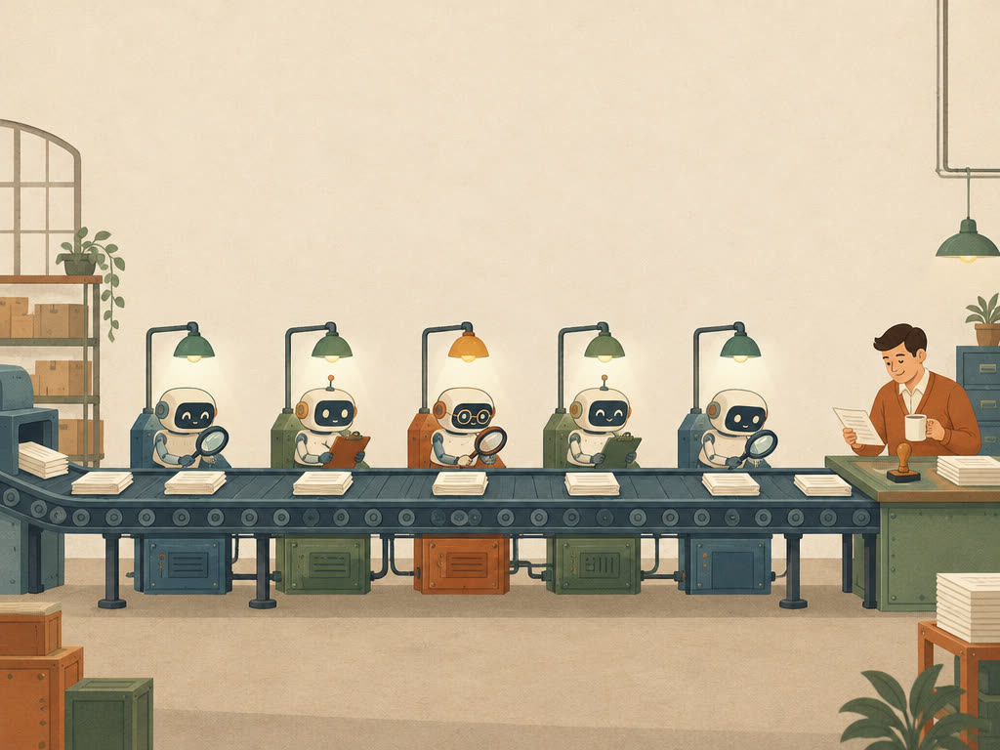
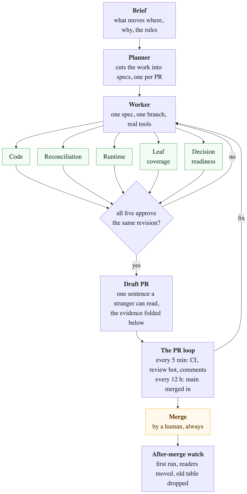
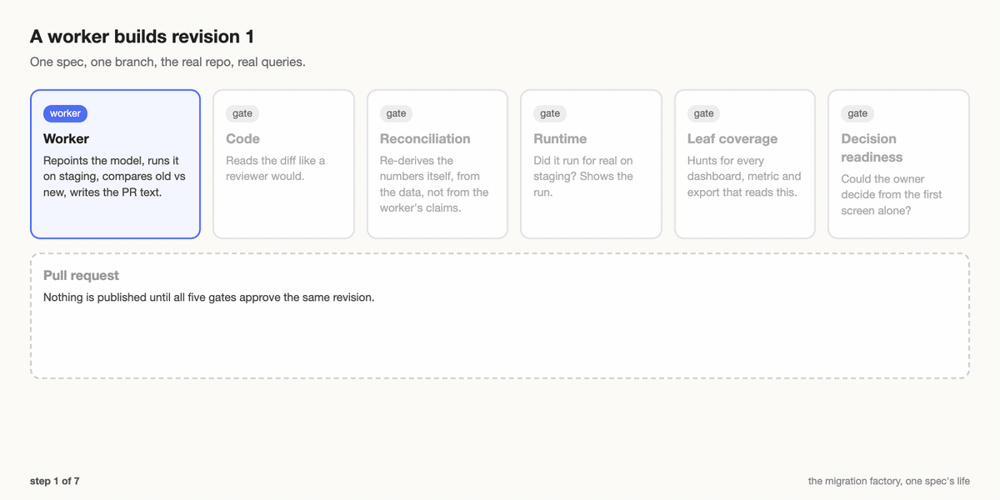
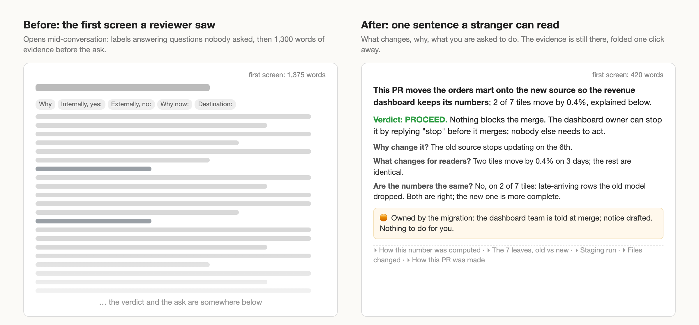

I got tired of data migrations that drag on for a year. So I built a small factory where AI agents do the work, other agents check it, and a human only shows up to decide.

## The problem

Every data platform I have worked on carries a backlog of migrations: move these tables to the new storage format, rename those metrics, repoint the last readers of a deprecated view. None of it is hard, all of it is tedious, and it always has the same shape: find everything that depends on the thing, change it, prove nothing moved for the people reading it, get the owner to merge, clean up.

What usually happens is that a platform team writes a very good document, sends a thousand-row to-do list to a hundred data engineers, and waits. A year later, 60% is done and the rest is "in progress".

The part that made me think a factory was possible is that the work is repetitive but the **decision** is not. Nobody wants to spend a day repointing a model and diffing two tables, but everybody wants to be the one who says "yes, this is right, merge it". The goal was never to remove humans, only to move them to the one place where they add something.

## What it is

The migration factory is a small program, a few thousand lines of Python and a SQLite file. You give it a **brief**: what moves where, why, and the rules of the house (what counts as a difference, who owns what, what a PR must say). It plans the work into **specs**, one per future pull request, and then it runs agents, several of them with different jobs, which is the whole point:

- A **worker** takes one spec, gets its own branch and checkout of the repo, and does the work with the tools you would use: dbt, staging, queries against the warehouse. It ends by writing the PR description and the evidence.
- Five **gates** then read that work. Each one is a separate agent with a narrow question, and none of them sees the others' opinions:
  - **Code**: does the diff do what the description says?
  - **Reconciliation**: re-derive the numbers yourself and compare.
  - **Runtime**: did this actually run on staging? Show me.
  - **Leaf coverage**: go find every dashboard, metric and export that reads this table, and compare your list with the worker's.
  - **Decision readiness**: could the owner decide from the first screen of this PR alone?
- Only when **all five approve the same revision** does the factory open a pull request.

If a gate says no, the spec goes back to the worker with the gate's words and a new revision goes through the gates again (gates whose inputs did not change keep their verdict). Here is one spec's life, sped up:

## Why the gates are blind

Because one agent reviewing its own work is worth nothing, and I learned that the expensive way. The first factory had the worker produce the evidence and a single reviewer agent read it. The reviews were glowing, until I opened the PRs myself and found claims like "byte-identical" above a comparison that was not. The reviewer had read the worker's summary of the comparison, not the comparison. <!-- MARC: a line on what that felt like, e.g. "I had been about to forward one of those to a very senior reviewer", or whatever actually happened -->

The gates are **blind**. The reconciliation gate gets the spec and the branch, not the worker's numbers, and runs the old and the new query itself. The leaf-coverage gate hunts for the downstream consumers on its own and then diffs its list with the worker's. A missed leaf or a phantom leaf is a fail. It costs more, and it catches things the cheap version did not.

## Prove it where someone reads it

What took the longest to get right is **where** the proof happens. A table diff tells you what changed, not whether it matters, because aggregation does not preserve small differences linearly: a row-level diff can be noisy while the metric is identical, or perfectly clean while the metric moves. The factory walks down to the **leaves** (the metric in the catalog, the dashboard tile, the export that leaves the warehouse), recomputes those both ways and reports in the reader's units: "2 of 7 tiles move by 0.4% on 3 days, here is why, here is who notices."

This is the same thing I wrote about in [PR reviews for SQL code](/PR-reviews-for-SQL-code) five years ago: review the result before the code. AI made it a lot easier to produce code that needs a review, and changed nothing about what a good review looks like.

## The PR nobody could read

The first PRs were enormous, 4,000 to 6,000 words, every comparison inline, no folds. Complete, and useless. I asked for a small mandatory read with everything else folded one click away, and the descriptions came down to about 1,300 words. Then a colleague who had no context opened one and told me the beginning "reads like it's answering in the middle of something. Why what? Internally yes to what?" <!-- clearance pending for this quote --> He was right. The description opened with labels that answered questions nobody had seen (**Why**, **Internally, yes:**, **Externally, no:**). Every gate had read that opening with the spec and the brief in context, so they filled in the gaps without noticing.

That is where the **cold reader** came from: a tiny, cheap agent that gets only the PR title and the first screen and has to say what changes, why, and what it is being asked to do. The decision-readiness gate has the spec and the brief in front of it. The cold reader has nothing. If it cannot answer, the PR does not ship. First screens went from about 1,300 words to about 400: one sentence a stranger can read, the verdict, what changes for readers, the ask, and everything else folded.

The first cold reader failed the PR on any phrase it could not interpret, and most of those were the factory's own labels ("Parity", "Register metric"), which no worker could change, so the PR looped until it ran out of rounds. Now it fails only on a real misunderstanding, and those labels became sentences. Reviewers had never complained about "Parity".

## Decide, don't ask

I also had to beat the question habit out of the agents. An early PR had seven items of the form "Owner's call on X?" and "Do you accept Y?". A reviewer who gets seven questions does not review. They schedule a meeting.

So the rule is: make the call a careful engineer would make, write it down under "Decisions I made" with the alternative you rejected and how to overturn it, and move on. The only things that may become a question for a human are a published number with no policy in the brief, a change outside the repo, or production access. Even those are phrased as a decision with an opt-out ("I set X. Reply 'use Y' to change it."). A PR proceeds with those and only holds on something that would break a reader or lose data.

The other half of that rule is that the next steps go to the **asset owner**, not back to the migration team. If the agent cannot do a step from where it sits, it writes the owner a runbook line with the command instead of "migration owner, please handle".

## After the merge

Merging is not the end: the old table still exists, readers have not moved, the first production run has not happened. The factory tracks that as a chain of small specs after each merge: wait for the first production run and check it, verify the readers moved, drop the old table on the date the brief says. Each step has a verifier, and the PR lists them so the owner knows what happens next.

## Staying on the PR

Opening a good PR turned out to be the easy half. A PR sits for days: CI goes red because the branch fell behind main, the review bot posts findings, a reviewer asks a question. The first loop noticed some of this and ignored the rest, and the first outside user watched CI fail on a stale branch and asked whether it was supposed to fix that.

Now every open PR is read at most every five minutes and the factory reacts. CI red on a stale branch means merge main and re-run, no agent involved. A real failure gets a worker with the log excerpt, three attempts per commit, then it asks. Every human comment gets an answer in its thread, and every branch gets main merged in every twelve hours. There is also one status comment per PR, edited in place, that says what the factory is doing ("CI red on lint: a worker is fixing it (round 1 of 3)"), which is the sign of life people were missing. It still never merges, never requests reviewers and never resolves a human's thread.

## What it cost, and what it caught

Numbers from the first migration, rounded: about 35 metrics to rename and rebuild, each a PR. A PR cost the factory on the order of $50 to $150 in agent time plus a few dollars of warehouse queries. <!-- MARC: a parenthetical on how that compares with an engineer-day, if you want to make the point --> The gates sent back roughly one revision in three, most of them deserved: a number claimed identical that was not, a downstream reader the worker had not found, a description that said "no change for readers" above a chart that moved. The reviews from the code owners were short. That was the goal.

What did not go well: the first wave of PRs had to be closed and redone after the format changed, agents sometimes took the slow path when a fast one existed, and I spent a lot of my own time answering "the loop is not converging" questions before CI and bot rounds stopped counting against the gate rounds. I also learned that a review bot will find edge cases in your edge-case handling for five rounds in a row, and that it is usually right.

## Where this goes

Nothing about a specific migration lives in the factory. That comes from the brief and from the repo's own documentation. The second migration (a storage move across three repositories) ran on the same code with a different brief, and a third team is now trying it on their own backlog.

Agents writing SQL is table stakes now. The interesting part is the shape around them, and if you run a platform team with a migration backlog, that is what I would copy first. Not the agents. The gates.

Special thanks to the colleagues who reviewed the first PRs and told me, politely, that they could not read them.

---

> **Credit where it is due.** I don't want to steal any credit here. This work is heavily inspired by several other projects I had the chance to witness at Shopify; I simply reshuffled them and assembled them in a way that made sense for data engineering. [Helix](https://shopify.engineering/helix), the tool behind the Shopify app's native rewrite, is one of them: small checkpoints and strict quality gates, which is the same idea with a different kind of code at the end.
